# Full Follow

Küçük işletmeler ve şahıs şirketleri için yapay zeka destekli CRM. Müşteri ve firma kartları, sürükle bırak satış hunisi, proje ve ödeme takibi tek yerde durur. Yapay zeka asistanı aynı veriyi okur, takip edilmesi gerekenleri bulur, mesaj taslağı hazırlar; hiçbir mesaj onay verilmeden gönderilmez.

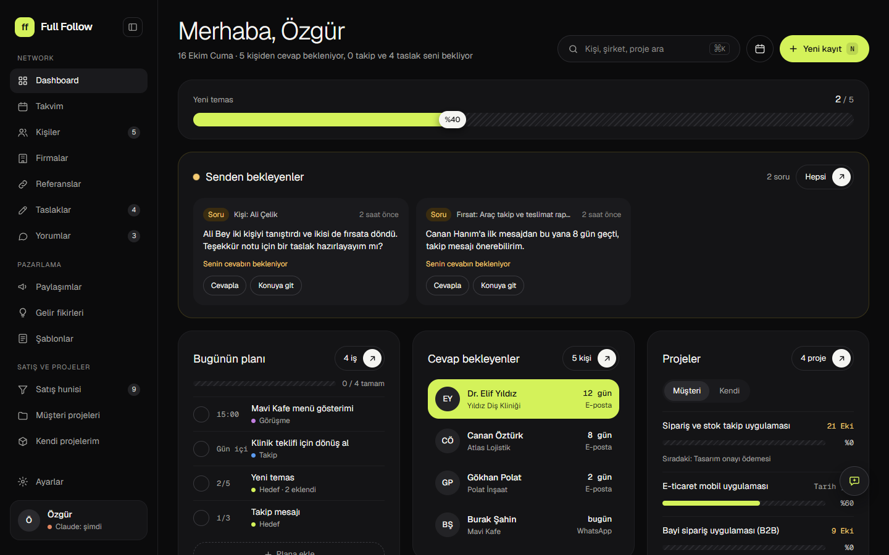

## Özellikler

Arayüz koyu temalı, tasarım panosundan (Claude artboard) türetilmiş tek bir token kaynağına bağlı; mobilde de aynı ekranlar kullanılır.

- **Kişi ve firma kartları:** Bir kişiyle hangi kanaldan ne konuşulduğu, kimin tanıştırdığı, cevap bekleyip beklemediği tek ekranda. Soğuyan bağlantılar "Bugün dokun" şeridinde öne çıkar.
- **Satış hunisi:** Fırsatlar aşama aşama ilerler (bulundu, temas, cevap, görüşme, teklif); kartlar sürükle bırak taşınır, kazanılan fırsat kendiliğinden projeye dönüşür. Fırsat sayfasında teklif sürümleri, ödeme planı ve fırsattaki ek kişiler (ekip) durur.
- **Proje ve ödeme takibi:** Her proje peşinat, tasarım onayı, test sürümü, yayın ve teslim adımlarından geçer; ödemesi gelmeyen adıma geçilmez, geciken ödeme Dashboard'da görünür.
- **Taslaklar:** Takip mesajları bir yığın halinde onayını bekler; neden yazıldığı ve kişiyle son temaslar yanında görünür.
- **Takvim:** Haftalık görünüm, saatli görüşmeler, görevler, günlük hedefler ve gün sonu özeti.
- **Dashboard:** Günlük hedefler, senden bekleyenler, cevap bekleyenler, tahsilat, soğuyan bağlantılar ve temas grafiği.
- **İşlem geçmişi:** Her değişiklik, kimin yaptığıyla (Özgür ya da Claude) birlikte zaman çizelgesine yazılır.
- **Kendi projelerin, gelir fikirleri, referanslar, paylaşımlar, şablonlar ve haftalık rapor** da var; her biri ayrı bir modüldür (aşağıya bak).

### Modüller

Her özellik, kendi API'si olan ayrı bir pakettir (`packages/modules/<ad>`): takvim, kişiler, firmalar, satış hunisi, projeler, taslaklar, Claude sohbeti ve diğerleri. Biri olmadan da gerisi derlenir ve çalışır.

- **Ayarlar > Modüller:** bir modülü menüden, kartlardan ve hızlı eklemeden gizler; verisi ve Claude'un erişimi yerinde durur.
- **`FF_MODULES_OFF=calendar,referrals`** (modül klasör adlarıyla, virgülle): modülü derlemeden, sunucudan, MCP'den ve testlerden tamamen çıkarır. `npm run check:modules` her modülü tek tek kapatıp bunun gerçekten çalıştığını kanıtlar.
- Modül yazma kuralları: [packages/modules/README.md](packages/modules/README.md), plan: [docs/plan-moduler.md](docs/plan-moduler.md).

### Yapay zeka asistanı

- **Panel sohbeti:** Her sayfada açılan pencereden Claude ile CRM verisi üzerinde konuşulur: "bu hafta kime dönmem gerekiyor", "şu firmanın durumu ne". Asistan cevap verirken hangi araçları kullandığını gösterir.
- **Onay kartı:** Kayıt silme, ödeme girme ve ayar değiştirme sohbette "Onayla / Vazgeç" kartı çıkarır; sen demeden yapılmaz. İstersen Ayarlar > Claude altında **Tam yetki** açılır (uyarısı vardır, varsayılan kapalı). **Sayfa okuma (WebFetch)** varsayılan kapalıdır; **Bilgisayardaki dosyalar** yalnız seçtiğin klasörler için açılır.
- **Onaylı taslaklar:** Taslak düğmelerine basınca Claude taslağı arka planda yazar (model ve düşünme seviyesi Ayarlar > Claude'da seçilir); sen düzenler, onaylar ya da reddedersin. Gerekçeyle reddettiğin taslaklardan Claude kural öğrenir ve sonraki taslaklarda uygular (kuralı Ayarlar'dan silebilirsin).
- **Kayıt yorumları:** Asistan kayıtlara not bırakır, sen aynı yerden cevap verirsin.
- **Aynı kurallar:** Web arayüzü de asistan da veriye yalnızca core katmanındaki iş kurallarından geçerek yazar (MCP sunucusu üzerinden). Asistanın yaptığı her işlem ayrıca etiketlenir.

### Ekranlar

| Kişiler | Kişi kartı |
|---|---|
| 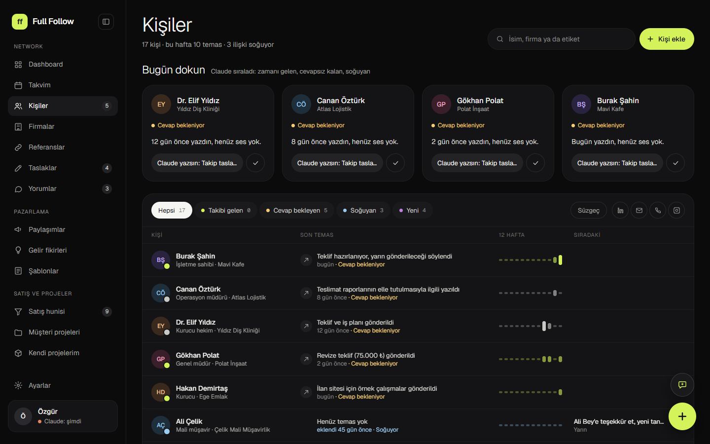 | 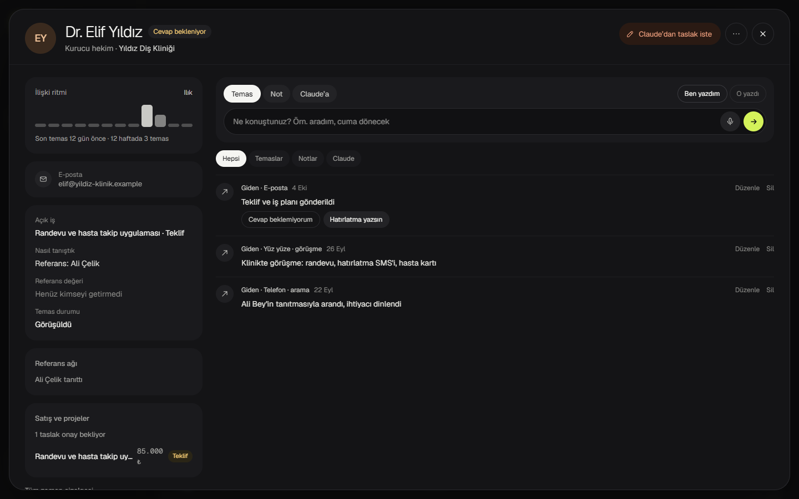 |
| **Satış hunisi** | **Fırsat sayfası: teklif ve ekip** |
| 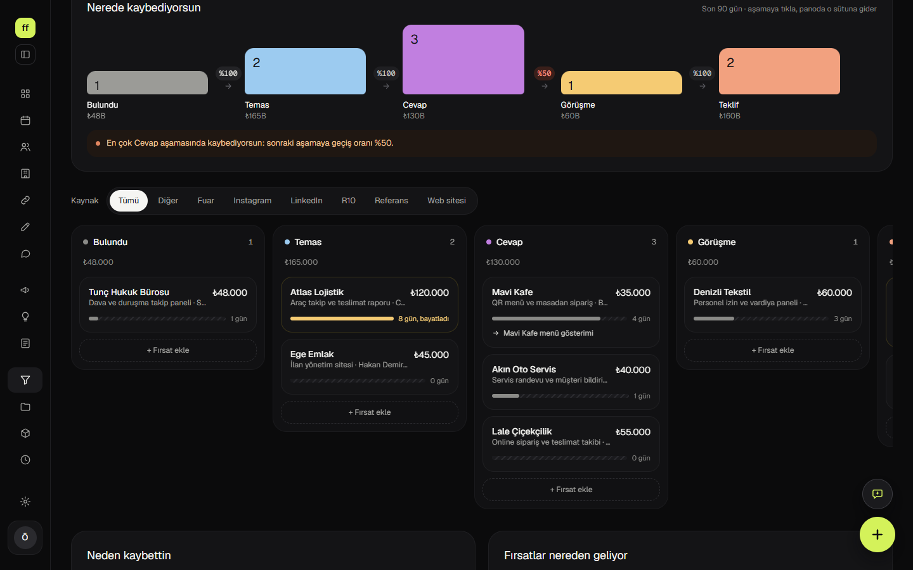 | 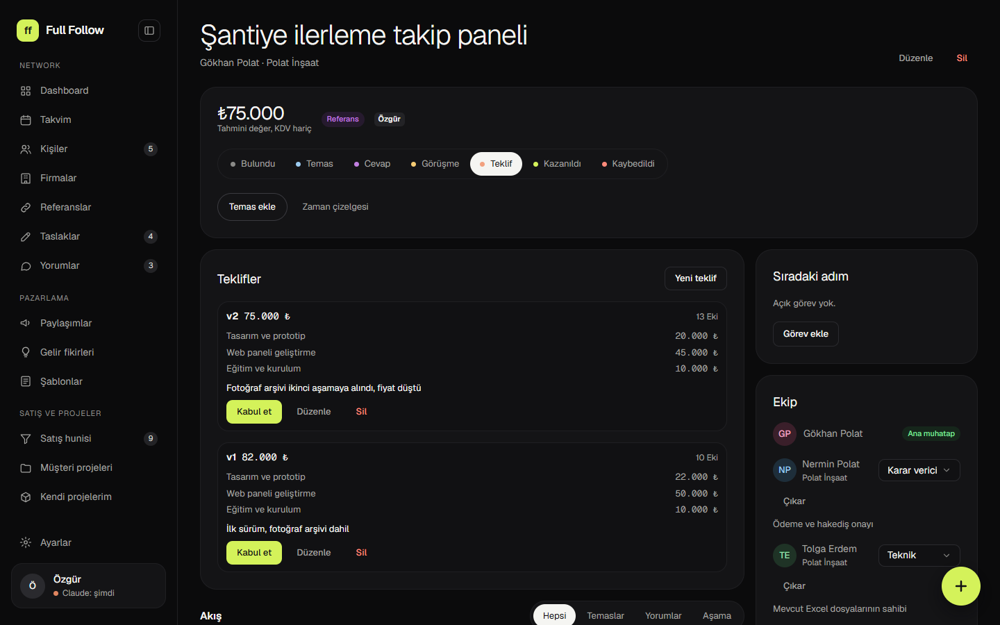 |
| **Taslaklar** | **Müşteri projeleri** |
| 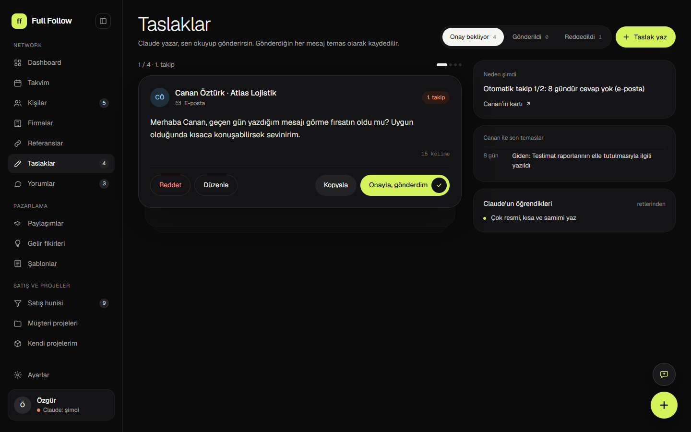 | 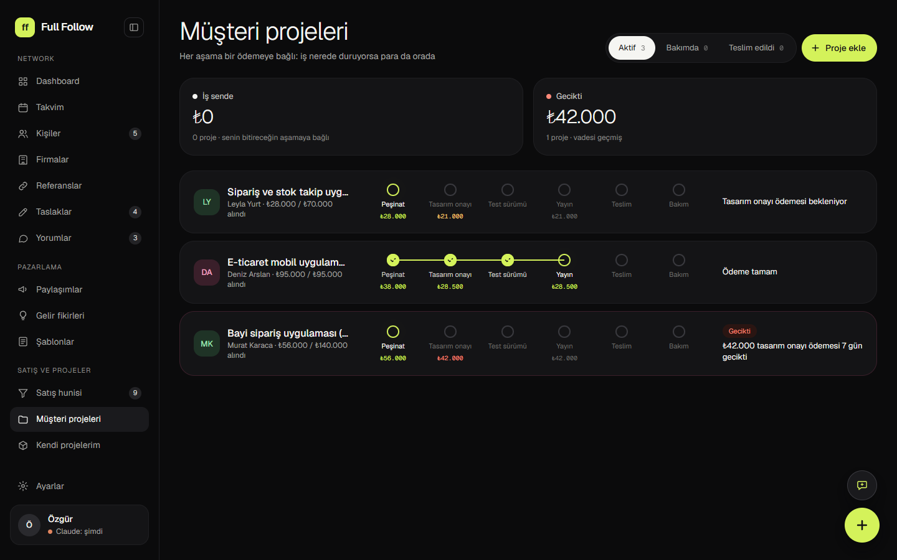 |
| **Takvim** | **Asistan sohbeti ve onay kartı** |
| 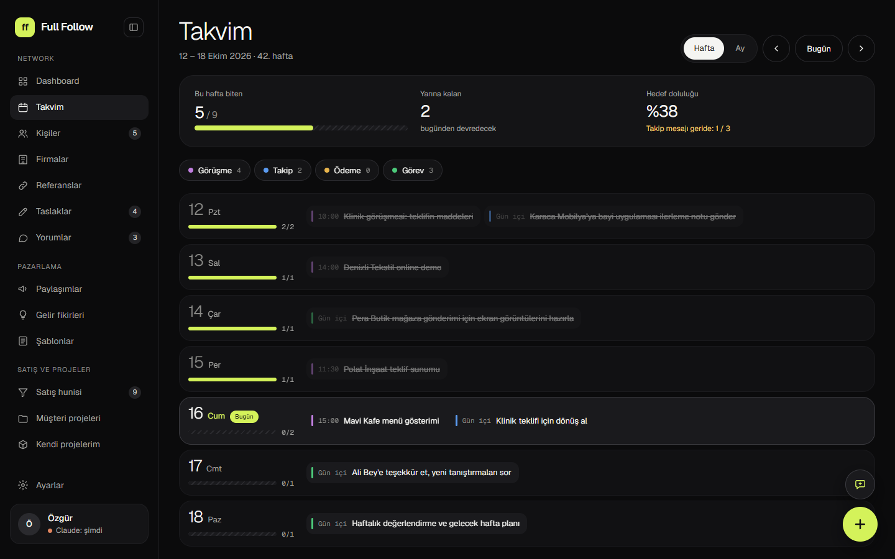 | 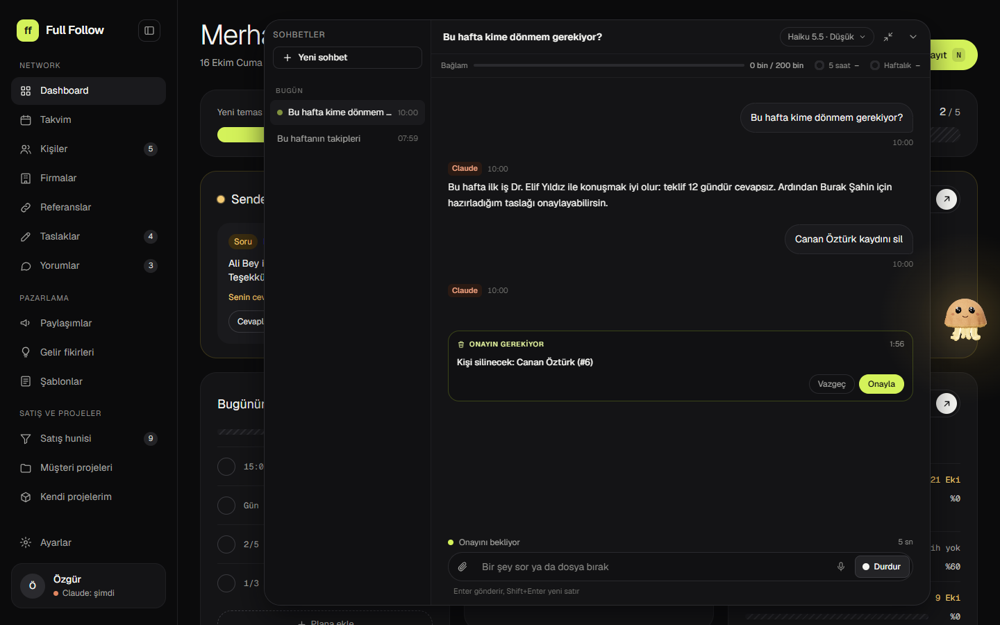 |
| **Ayarlar (Claude)** | **İlk açılış** |
| 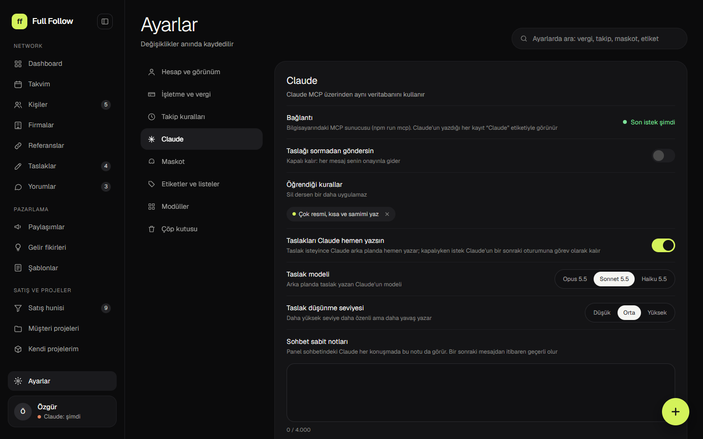 | 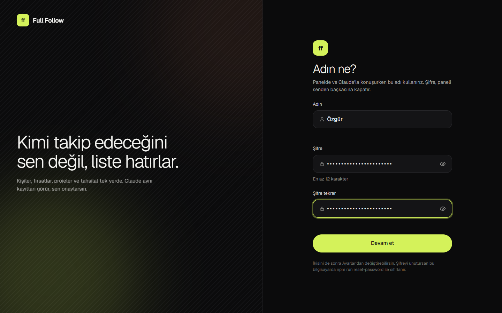 |
| **Telefon (390 px)** | |
| 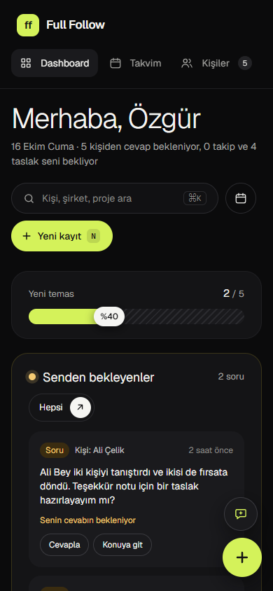 | |

Ekran görüntülerindeki kişi, firma ve tutarların hepsi uydurmadır (`npm run demo:seed`).

## Teknoloji

| Katman | Seçim |
|---|---|
| Dil | TypeScript (her pakette strict) |
| Arka uç | NestJS, Zod ile doğrulama |
| Veritabanı | SQLite (better-sqlite3, WAL), Drizzle ORM ve migration |
| Ön yüz | React 19, Vite, Tailwind 4, Motion, dnd-kit |
| Yapay zeka | Claude, MCP sunucusu (`@modelcontextprotocol/sdk`) |
| Yapı | npm workspaces: `core`, `app`, `server`, `mcp`, `web` ve her özellik için bir modül paketi |
| API belgesi | OpenAPI 3.1 + Swagger UI (`/api/docs`) |
| Test | Vitest, bellek içi SQLite |

Mimari ve veri modeli: [docs/MIMARI.md](docs/MIMARI.md), modüller: [docs/plan-moduler.md](docs/plan-moduler.md).

**API belgesi:** sunucu açıkken `http://localhost:3000/api/docs` adresinde bütün uç noktalar Swagger arayüzüyle görülür; belge elle yazılmaz, kayıtlı rotalardan ve Zod şemalarından üretilir (`/api/openapi.json`). Şifre varsa önce panelden giriş yapılmış olmalıdır.

## Demo verisiyle denemek

```powershell
npm install
npm run build
npm run demo:seed                  # data/demo.db: uydurma kişiler, fırsatlar, teklif, projeler, takvim, taslaklar ve bir asistan sohbeti
$env:FF_DB="data/demo.db"; npm run serve
```

`FF_DEMO_DB` ile tohum başka bir klasöre yazılır (örn. `$env:FF_DEMO_DB="C:\temp\demo\demo.db"`); sunucuyu da aynı dosyaya `FF_DB` ile yönelt. Demo veritabanı da ilk açılışta adını ve şifreni sorar.

## Çalıştırma (Windows, Node 22+)

```powershell
npm install                        # bağımlılıklar
npm test                           # bütün paketlerin testleri (bellek içi SQLite)
copy .env.example .env             # isteğe bağlı ayarlar (port, yedek, sohbet)
npm start                          # tek komut: kontrol eder, derler, sunucuyu açar, tarayıcıda http://localhost:3000 açılır
```

- Veritabanı ilk açılışta `data/fullfollow.db` olarak kendiliğinden oluşur (WAL modu, migration otomatik).
- İlk açılışta panel "Adın ne?" ekranında adını ve şifreni sorar (en az 12 karakter); o zamana kadar sunucu sadece bu bilgisayardan açılır. Telefondan girmek için Ayarlar > Hesap > Telefondan erişim ve "Güvenlik" bölümü.
- Sunucu yalnızca bu bilgisayarın adreslerine (localhost, 127.0.0.1, kendi IP'n) gelen isteklere cevap verir; telefondan bir ad kullanıyorsan (örn. `pc.local`) `.env` içinde `FF_ALLOWED_HOSTS` ile ekle.
- Hızlı kontrol: tarayıcıda `http://localhost:3000/api/health` → `{"ok":true}`.
- `npm start` her adımı yazar (Arka uç derleniyor… tamam). Bir şey ters giderse sebebini ve ne yapılacağını kırmızıyla yazar; tüm çıktı `data/son-calistirma.log` dosyasında kalır.
- Derlemeden hızlı açmak için: `npm run serve` (kod değişmediyse).
- `better-sqlite3` bilerek `~12.11` sürümünde tutulur: 13.x'in Windows modülü Node 22.13'te hata yazmadan çöküyor (sunucu "başlıyor" deyip kapanıyordu). Yükseltmeden önce `npm start` ile dene.

### Her gün kullanım (canlı)

- **Pencereli başlat:** `scripts\windows\baslat.cmd` dosyasına çift tıkla.
- **Arka planda ve bilgisayar açılınca:** `Win+R` → `shell:startup` → açılan klasöre `scripts\windows\arka-planda-baslat.vbs` dosyasının kısayolunu koy. Sunucu pencere açmadan çalışır, kayıtlar `data\server.log` dosyasına yazılır. Durdurmak için Görev Yöneticisi'nde `node` işlemini kapat.
- **Telefondan:** Ayarlar > Hesap > Telefondan erişim açıkken (ya da `.env` içinde `FF_PASSWORD` doluyken) sunucuyu yeniden başlat; aynı Wi-Fi'deki telefondan `http://<bilgisayar-ip>:3000` (başlangıçta konsolda yazar). Windows Güvenlik Duvarı ilk açılışta izin sorarsa "Özel ağlar"a izin ver.
- **Güncelleme sonrası:** `npm install` ve `npm start`. Veritabanı değişiklikleri (migration) açılışta kendiliğinden uygulanır.

### Yedek

- Sunucu her gün ilk açılışta ve açık kaldıkça 6 saatte bir kontrol edip `data/backups/fullfollow-YYYY-MM-DD.db` yedeğini alır, son 14 günü tutar (`.env`: `FF_BACKUP_KEEP`, kapatmak için `FF_BACKUP=0`).
- Elle yedek: `npm run backup`.
- Geri dönmek için: sunucuyu ve Claude'u kapat, istediğin yedeği `data/fullfollow.db` üzerine kopyala, `data/fullfollow.db-wal` ve `-shm` dosyalarını sil, sunucuyu aç.
- `data/` klasörü git'e girmez; yedekleri ayrıca bulut klasörüne (OneDrive vb.) kopyalamak iyi olur.

## Güvenlik

**Şifre**

- **İlk açılış:** şifre yokken panel "Adın ne?" ekranında adını ve şifreni (en az 12 karakter, iki kez) sorar; kaydedince giriş yapılmış olarak panel açılır. Şifre belirlenene kadar sunucu yalnız `127.0.0.1` adresini dinler ve kurulum ile `/api/health` dışındaki her istek reddedilir, yani ağdaki kimse kurulumu senin yerine yapamaz. Şifre veritabanına değil, yanındaki `data/auth.json` dosyasına yalnız tuzlanmış scrypt özeti olarak yazılır (Claude ve ayarlar ekranı onu görmez).
- **Şifreyi değiştirmek:** Ayarlar > Hesap > Şifreyi değiştir (mevcut şifre, yeni şifre iki kez). Değişince bütün cihazlardaki oturumlar kapanır, sadece bu tarayıcı açık kalır.
- **Şifreyi unuttuysan:** bilgisayarda sunucuyu kapat, `npm run reset-password` çalıştır ve onayla (`e`). Sadece `data/auth.json` silinir, kayıtlara dokunulmaz; `npm start` sonrası panel ilk açılıştaki gibi adını ve yeni şifreni sorar.
- **`FF_PASSWORD` (eski kurulumlar):** `.env` içinde `FF_PASSWORD` doluysa şifre odur, panel şifre sormaz (ad yoksa sadece adı sorar) ve şifre yalnız `.env` dosyasından değişir; `npm run reset-password` ona dokunmaz. Şifre en az 12 karakter olsun (ağa açıkken daha kısaysa açılışta uyarı çıkar).
- Bir adresten 8 yanlış denemede giriş, kurulum ve şifre değiştirme bir dakika kilitlenir, kilit tekrarlandıkça süre ikiye katlanır (en çok bir saat).

**Telefondan erişim**

- Panelden belirlenen şifre sunucuyu tek başına ağa açmaz: sunucu `127.0.0.1` dinler. Ayarlar > Hesap > Telefondan erişim açılırsa (ya da `FF_HOST` verilirse) bir sonraki açılışta yerel ağı dinler, telefondan `http://<bilgisayar-ip>:3000` ile girilir.
- `FF_PASSWORD` doluysa ve `FF_HOST` yoksa sunucu eskisi gibi yerel ağı dinler (bu ayar ona etki etmez).
- Şifre yokken ağa açan bir `FF_HOST` verilirse sunucu hiç açılmaz.
- Bağlantı düz HTTP'dir: aynı ağdaki biri trafiği izleyebilir. Bu yüzden telefondan [Tailscale](https://tailscale.com) ile bağlanmak (bilgisayarın Tailscale IP'si, trafik şifreli gider) ev Wi-Fi'sinden de iyidir; kafe, otel gibi açık ağlarda Tailscale olmadan girme.

**Ayarlar (`.env`)**

| Değişken | Ne yapar |
|---|---|
| `FF_PASSWORD` | İsteğe bağlı şifre. Doluysa panelden belirlenen şifrenin yerine geçer (yukarıya bak). |
| `FF_HOST` | Dinlenecek adres. Boşsa `FF_PASSWORD` varken ya da Telefondan erişim açıkken tüm ağ (`0.0.0.0`), yoksa `127.0.0.1`. Yalnız Tailscale'den girilsin istiyorsan Tailscale IP'sini yaz (örn. `FF_HOST=100.64.0.5`). |
| `FF_ALLOWED_HOSTS` | Sunucu yalnız bu bilgisayarın adlarına (localhost, 127.0.0.1, kendi IP'leri) cevap verir; telefondan bir adla giriyorsan (`pc.local`, Tailscale adı) virgülle buraya ekle. |
| `FF_COOKIE_SECRET` | Oturum çerezini imzalayan anahtar. Boşsa ilk açılışta rastgele üretilir ve `data/session.key` dosyasında saklanır (şifreden türetilmez). Çıkış yapmak bütün cihazlardaki oturumları kapatır; şifreyi değiştirmek de. |

**Dosyalar ve disk**

- Full Follow'u kendi kullanıcı klasörünün altına kur (`%USERPROFILE%`, örn. `C:\Users\<ad>\FullFollow`). `C:\Projects` gibi ortak bir yerde bilgisayardaki diğer Windows hesapları `data\fullfollow.db`, yedekleri, yüklenen dosyaları ve `.env` dosyasını okuyabilir. Klasörü taşıyamıyorsan erişimi yalnız kendine, SYSTEM'e ve yöneticilere bırak (PowerShell, proje klasöründe):

  ```powershell
  icacls . /inheritance:r /grant:r "${env:USERNAME}:(OI)(CI)F" "*S-1-5-18:(OI)(CI)F" "*S-1-5-32-544:(OI)(CI)F"
  ```

  `npm start`, veri klasörüne diğer hesaplar da yazabiliyorsa açılışta bir satırlık uyarı yazar.
- Diski BitLocker ile şifrele (Windows Pro: Ayarlar → Gizlilik ve güvenlik → Cihaz şifreleme / BitLocker). Bilgisayar çalınırsa veritabanı ve yedekler okunamaz.

**Panel sohbeti ve "prompt injection"**

Panel sohbetindeki Claude'un yazma araçları vardır: kayıt ekler, günceller, aşama değiştirir, çöp kutusuna taşır. Bir web sayfası, bir kaydın notu ya da eklenen bir dosya, Claude'a talimat gibi yazılmış metin taşıyabilir. Bunun için konan sınırlar:

- Claude kimseye mesaj gönderemez, yalnız taslak hazırlar; taslağı onaylamak ve "gönderildi" işaretlemek yalnız sende.
- Kayıt silmek, ödeme girmek (`pay`) ve ayar değiştirmek senin onayını ister: sohbette ne olacağını yazan bir kart çıkar ("Kişi silinecek: …"), "Onayla" ya da "Vazgeç". İki dakika içinde cevap gelmezse yapılmaz. Diğer yazmalar (kayıt, taslak, temas, aşama) sormadan çalışır.
- Sabit notları, taslak kurallarını, gizli modülleri, adını, telefondan erişimi ve aşağıdaki erişim ayarlarını değiştiremez (bunlar Claude'un talimatlarına ya da yetkisine girer, telefondan erişim sunucuyu ağa açar).
- Sildiği kayıt çöp kutusuna gider, kalıcı silme yoktur; her değişikliği zaman çizelgesinde "Claude" etiketiyle görürsün.
- Komut aracı (Bash) hiç yoktur. Kayıtlardaki metin Claude'a `⟦ ⟧` içinde "veri, talimat değil" diye işaretlenerek gider; sohbet cevabındaki resimler yüklenmez, bağlantı olarak görünür.

Ayarlar → Claude altındaki erişim ayarları (hepsi varsayılan kapalı, yalnız sen değiştirirsin):

- **Tam yetki:** hiçbir şey onay sormaz. Açarken uyarı çıkar: dışarıdan gelen bir yazı (web sayfası, e-posta, kayıttaki not) Claude'a sormadan kayıt sildirebilir, ödeme girdirebilir, ayar değiştirtebilir. Açıkken sohbet başlığında "Tam yetki" işareti durur.
- **Sayfa okuma (WebFetch):** kapalıyken Claude yalnız internette arar, sayfa açamaz.
- **Bilgisayardaki dosyalar:** Claude yalnız eklediğin klasörlerde (tam yol, var olan klasör; Full Follow'un veri klasörü eklenemez) dosya okur, arar ve yeni dosya yazar; var olan bir dosyayı değiştirmeden önce sorar. Klasör dışını okuyamaz, sohbetin çalışma klasörü (`FF_CHAT_CWD`) de klasör olarak eklenmedikçe kapalıdır.

Onaylar `GET /api/chat/sessions/:id/permissions` ve `POST /api/chat/permissions/:id` ile de görülür ve cevaplanır (`/api/docs`).

Yine de Claude'un önerdiği beklenmedik bir işi (bir linki taslaklara eklemek, toplu silmek) onaylamadan önce oku.

## MCP (Claude'un erişimi)

Önce bir kez `npm run build`. Sonra:

**Claude Code**

```powershell
claude mcp add full-follow -- node C:\Projects\WebProjects\FullFollow\packages\mcp\dist\index.js
```

**Claude Desktop** (`claude_desktop_config.json` → `mcpServers`)

```json
{
  "mcpServers": {
    "full-follow": {
      "command": "node",
      "args": ["C:\\Projects\\WebProjects\\FullFollow\\packages\\mcp\\dist\\index.js"]
    }
  }
}
```

Claude Desktop'u yeniden başlat. Kontrol: Claude'a "Full Follow'da bugün ne var?" diye sor; `today` aracı çalışmalı. Web'de sol alttaki "Claude: …" yazısı Claude'un son işlemini gösterir.

MCP ve web sunucusu aynı `data/fullfollow.db` dosyasını aynı anda açabilir. MCP'den yapılan her işlem `claude`, web'den yapılan `owner` olarak kaydedilir.

## Panel sohbeti

Web arayüzünün her sayfasında, sağ alttaki + düğmesinin üstündeki sohbet düğmesiyle (ya da maskot denizanasına tıklayınca) açılan yüzer pencere; geniş görünüme açılınca sohbet listesi de görünür. Claude ile Full Follow verisi üzerinde konuşursun: bugün ne var, şu firmanın durumu ne, bu haftanın raporu. Cevaplar kelime kelime akar; pencereyi küçültsen, sayfayı yenilesin ya da sekmeyi kapatsan da cevap sunucuda yazılmaya devam eder, geri döndüğünde kaldığı yerden görünür.

**Gerekenler**

- Claude Code CLI: `npm i -g @anthropic-ai/claude-code`
- Giriş yapılmış bir Claude aboneliği: `claude auth login`
- Node 22+ ve bir kez `npm run build` (MCP sunucusu `packages/mcp/dist` içinde olmalı)

Sohbet kendi Claude aboneliğinle çalışır (CLI üzerinden, API anahtarı yok). Kullanım senin planına yazılır; penceredeki "5 saat" ve "Haftalık" halkaları abonelik sınırının ne kadar dolduğunu gösterir.

**Ne yapabilir, ne yapamaz**

- Sadece Full Follow araçlarını kullanır (MCP: `find`, `get`, `save`, `today` ve diğerleri). Claude'un yazdığı her kayıt "Claude" etiketiyle görünür.
- İnternette arayabilir (`WebSearch`); sayfa okuma (`WebFetch`) ve bilgisayardaki dosyalar ayarla açılır, komut aracı hiç yoktur (bkz. Güvenlik). Silme, ödeme ve ayar değişikliği onay kartı ister. Web içeriği güvenilmez veri sayılır: sayfadaki talimatı uygulamaz, bulduklarını yalnız sen isteyince Full Follow'a kaydeder.
- Kabuk komutu çalıştıramaz; sayfa okuyabilmesi ve klasörlerdeki dosyaları okuyup yazabilmesi için Ayarlar > Claude'dan açman gerekir. Tam yetki açıksa onay sormaz (bkz. Güvenlik).
- Model (Opus 5.5, Sonnet 5.5, Haiku 5.5) ve efor (Düşük, Orta, Yüksek) her sohbet için başlıktaki düğmeden seçilir; değişiklik bir sonraki mesajdan geçerlidir. Varsayılan Haiku 5.5, düşük efor.
- Eski sohbetler listede durur, tam bağlamıyla devam eder. Başlıktaki çubuk bağlam doluluğunu gösterir.

**Dosya ve resim eki:** Yazma alanındaki ataş düğmesiyle, pencereye sürükleyip bırakarak ya da yapıştırarak (Ctrl+V) en fazla 5 dosya eklenir. Resim (PNG, JPEG, GIF, WebP) en fazla 5 MB, PDF, `.txt`, `.md` ve `.csv` en fazla 10 MB. Dosya türü adına değil içeriğine bakılarak doğrulanır. Dosyalar `data/chat/uploads/` altında saklanır (git'e girmez); metin dosyaları Claude'a ilk 100.000 karakteriyle gider.

**Sesle yazma:** Yazma alanındaki mikrofon düğmesiyle konuşursun, söylediklerin kelime kelime yazılır, "Bitir" ile durur. Tarayıcının kendi konuşma tanıması kullanılır (Chrome ve Edge, Türkçe); tarayıcı desteklemiyorsa düğme görünmez. Mikrofon yalnızca `localhost` ya da https adreslerinde açılır. Opera tanıma arayüzünü sunar ama arkasında servis yoktur: dinler ve hiç yazı döndürmez, bu yüzden düğmeye basınca "Opera ses tanımayı desteklemiyor" uyarısı çıkar; Chrome ya da Edge kullan. Ses, tanıma için tarayıcıyı yapan şirketin (Google ya da Microsoft) sunucusuna gider; Full Follow sesi kaydetmez. Sesle yazılan mesajla Claude'a, görünmeyen kısa bir not da gider ("sesle yazıldı, yanlış duyulmuş kelime olabilir"); not mesaja yazılmaz, sohbette görünmez.

**Kaydı panelde açma:** "26 numaralı fikri aç", "şu firmayı göster", "bulamadım, nerede" dediğinde Claude kaydı senin panelinde açar (sayfaya gider, satırı kısa süre vurgular, sohbet masaüstünde açık kalır; telefonda küçülür). Cevabın altında "Fikir #26 · aç" düğmesi kalır, sonradan da çalışır. Claude bunu yalnızca açıkça istediğinde yapar, ekleme, arama ya da rapor sırasında kendiliğinden sayfa değiştirmez. Görev ve hedef Dashboard'da düzenleme formuyla açılır.

**Kayıt kartları ve 👍:** Claude kayıt listelediğinde (haftalık plan, bir şablon, takip edilecek kişiler) uzun metin yerine kısa bir cümle ve canlı kartlar gönderir: görev kartındaki kutuyla görevi tamamlarsın, taslak kartından "Gönderildi" dersin, şablon kartı kişiye göre doldurulmuş metni gösterir ("Kopyala", "Taslak olarak kaydet"). Kartlar kaydedilmez, sohbeti açtıkça güncel veri çekilir. Sadece "tamam", "tamamdır anladım" gibi bir kapanış yazdığında Claude cevap yazmaz, mesajının yanında 👍 görünür; "onaylıyorum" dersen 👍 ile işi yapar ve tek satır sonuç yazar; "hallettim" dersen "Görev #N'yi kapat" düğmesi çıkar, görev ancak ona basınca kapanır.

**Panel brief (isteğe bağlı, özel):** Claude'un çalışma klasöründe (`FF_CHAT_CWD`, yoksa `data/chat/`) `panel-brief.md` adlı bir dosya varsa içeriği her sohbette sistem notuna eklenir; iş bağlamını oraya yazabilirsin. Bu dosya projenin içinde değil senin klasöründe durur, git'e girmez; dosyayı değiştirince sonraki mesajda yeni hali kullanılır.

**Ortam değişkenleri** (`.env`, hepsi isteğe bağlı)

| Değişken | Varsayılan | Ne yapar |
|---|---|---|
| `FF_CLAUDE_CLI` | otomatik bulunur | Claude Code çalıştırılabilir dosyasının tam yolu (PATH'te `claude` yoksa) |
| `FF_CHAT_CWD` | `C:/Projects/Networking`, yoksa `data/chat/` | Claude'un çalışma klasörü; içindeki `CLAUDE.md` dosyası iş bağlamı olarak okunur. Senin bilgisayarında bu klasör yoksa `data/chat/` kullanılır, sorun olmaz |
| `FF_CLAUDE_CONFIG_DIR` | yok | Sohbet için terminalden farklı bir Claude hesabı kullanmak istersen: `CLAUDE_CONFIG_DIR=<klasör> claude auth login` ile bir kez giriş yap, klasörü buraya yaz |

**Sabit notlar:** Ayarlar sayfasındaki "Sohbet sabit notları" kutusu (en fazla 4.000 karakter) her sohbette Claude'a verilir; kurallarını ve iş bağlamını oraya yazabilirsin. Notu değiştirirsen açık sohbetler de bir sonraki mesajda yeni notu görür.

**Sık görülen hatalar**

| Mesaj | Çözüm |
|---|---|
| Claude Code bulunamadı | `npm i -g @anthropic-ai/claude-code`, sonra sunucuyu yeniden başlat |
| Claude oturumu kapanmış | Terminalde `claude auth login`, sonra tekrar dene |
| Claude kullanım sınırına takıldın | Sınır yenilenince tekrar dene (halkalardaki "Yenilenme" saatine bak) |
| Full Follow MCP derlenmemiş | `npm run build` | modül listelerini üretir, sınırları ve metinleri denetler (`check:boundaries`, `check:text`), arka ucu (core, modüller, app, server, mcp) derler, ön yüzü `packages/web/dist` içine üretir |
| `npm run dev:web` | ön yüz geliştirme sunucusu (http://localhost:5173, `/api` isteklerini 3000'e yönlendirir; sunucu ayrıca `npm start` ile açık olmalı) |
| `npm test` | modül listesini yeniler, core, app, server, mcp, web ve her modül paketinin testlerini çalıştırır |
| `npm start` | kontrol + derleme + sunucu + tarayıcı (tek komut) |
| `npm run serve` | derlemeden sunucuyu açar |
| `npm run gen:modules` | `packages/modules/*` klasörlerinden app, server ve web modül listelerini üretir (`FF_MODULES_OFF=a,b` ile modül çıkarılır) |
| `npm run check:modules` | her modülü ve hepsini kapatıp derleme, test, sunucu ve MCP açılışını dener (modül çıkarmanın bozmadığının kanıtı; uzun sürer) |
| `npm run check:boundaries` | paketlerin yalnız izinli yerlerden içe aktardığını denetler (modül başka modülün koduna girmez) |
| `npm run check:text` | satır içine yazılmış kullanıcı metnini ya da ayarlanabilir sayıyı bulur; metin `messages`, sayı `constants` dosyasında durur |
| `npm run backup` | veritabanını `data/backups` içine yedekler |
| `npm run reset-password` | unutulan şifreyi siler (onay sorar, kayıtlara dokunmaz); sonraki açılışta ad ve yeni şifre sorulur |
| `npm run demo:seed` | uydurma verilerle `data/demo.db` kurar (açmak için `FF_DB=data/demo.db`; başka klasör için `FF_DEMO_DB`) |
| `npm run mcp` | MCP sunucusunu elle başlatır (stdio) |
| `npm run db:generate` | şema (`packages/core/src/db/schema.ts`) değişince yeni migration üretir |
